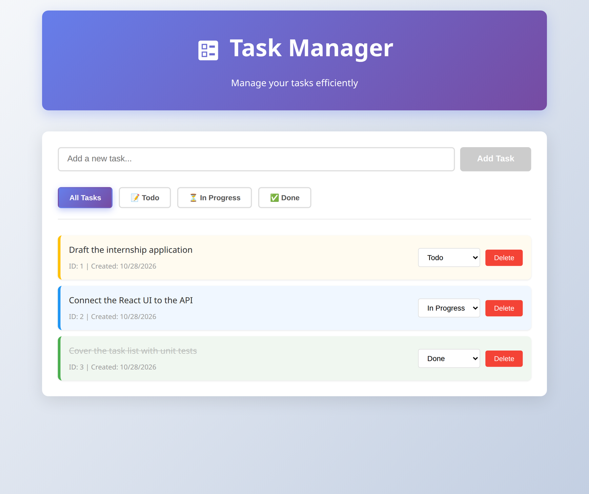
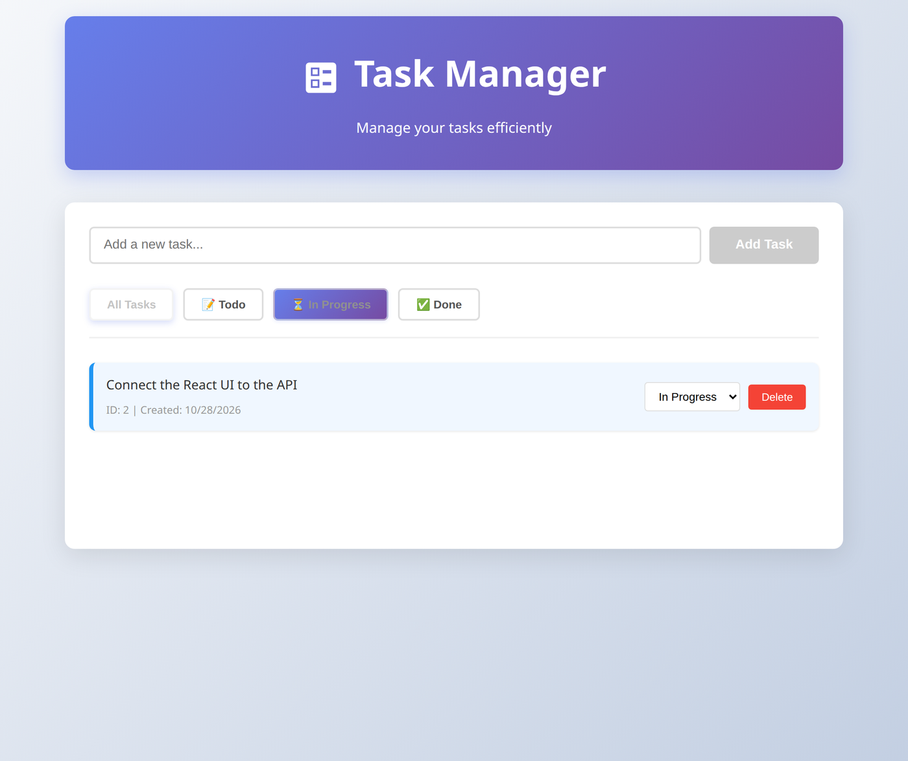
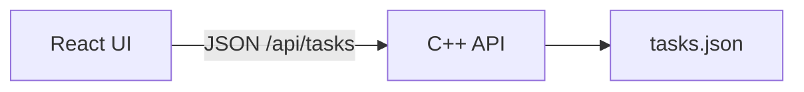

# Task Tracker

[](https://github.com/joelng25/Task-Tracker/actions/workflows/ci.yml)
[](https://github.com/joelng25/Task-Tracker/actions/workflows/api.yml)

A React and TypeScript task board backed by a C++ REST API, with Docker, GitHub Actions, and a live demo.

## Live demo

| Service | URL |
|---|---|
| App | [https://task-tracker-web-4uqz.onrender.com](https://task-tracker-web-4uqz.onrender.com) |
| API | [https://task-tracker-api-fak9.onrender.com](https://task-tracker-api-fak9.onrender.com) · [GET /api/tasks](https://task-tracker-api-fak9.onrender.com/api/tasks) |

The frontend and API are two free Render services ([`render.yaml`](render.yaml)). Both run on Render's free tier and sleep when idle, so **the first load can take about 15 seconds** while the app and API wake up; after that it responds normally. Task data lives in the API container and is cleared when that service restarts or redeploys.

The same UI can be hosted on Vercel. See [Deploy the frontend on Vercel](#deploy-the-frontend-on-vercel). There is no Vercel URL until that project is imported.

## Screenshots

Local run of this frontend against the local API.





## Features

- Add a task with a description
- List tasks, and filter by todo, in progress, or done
- Change a task's status from the row
- Delete a task
- Save tasks in a JSON file on the API
- Reject bad input (`400`) and unknown ids (`404`). A failed save returns `500` and leaves the previous file in place

## Tech stack

| Layer | Choice |
|---|---|
| API | C++17, [cpp-httplib](https://github.com/yhirose/cpp-httplib), [nlohmann/json](https://github.com/nlohmann/json) |
| Frontend | React 19, TypeScript, Vite |
| Frontend tests | Vitest, Testing Library |
| API tests | GoogleTest, plus a Python HTTP regression script |
| Containers | Docker Compose locally, Docker on Render |
| CI | GitHub Actions (API, frontend, and a Compose smoke test) |
| Hosting | Render for the live demo. Vercel config for the frontend |

The HTTP API grew out of the command-line app in [`Task-Tracker-CLI/`](Task-Tracker-CLI/) (also published as [joelng25/Task-Tracker-CLI](https://github.com/joelng25/Task-Tracker-CLI)).

## Architecture



The browser never reads the file. It talks to four routes on the API:

| Method | Path | Body |
|---|---|---|
| `GET` | `/api/tasks` | Optional `?status=todo\|in-progress\|done` |
| `POST` | `/api/tasks` | `{ "description": "..." }` |
| `PUT` | `/api/tasks/:id` | `{ "status": "todo" \| "in-progress" \| "done" }` |
| `DELETE` | `/api/tasks/:id` | — |

How the UI finds that API depends on where it is hosted:

- **Local `npm run dev`.** `VITE_API_URL` defaults to `http://localhost:8080/api`. The API allows `http://localhost:3000` via `CORS_ORIGIN`.
- **Docker Compose.** The image is built with `VITE_API_URL=http://localhost:8080/api`. The API port is published on the host, and tasks are stored in a Docker volume.
- **Render.** The frontend image defaults `VITE_API_URL` to `/api`. nginx in that container proxies `/api/` to `TASK_API_URL` (the public API URL in `render.yaml`), so the browser stays on one origin.
- **Vercel.** There is no nginx proxy. The browser calls the API directly. Set `VITE_API_URL` to `https://task-tracker-api-fak9.onrender.com/api`. The Render API currently sends `Access-Control-Allow-Origin: *`, which covers a Vercel domain.

`VITE_API_URL` is read in [`task-tracker-web/src/services/taskService.ts`](task-tracker-web/src/services/taskService.ts). Vite inlines it at build time. A trailing slash is removed. See [`.env.example`](task-tracker-web/.env.example) for the three usual values. Do not put secrets in that variable or in git. The demo API URL is public.

## Run locally

### Docker

```bash
docker compose up --build
```

App: [http://localhost:3000](http://localhost:3000). API: [http://localhost:8080](http://localhost:8080).

### API only

Needs a C++17 compiler and make. Tests also need GoogleTest.

```bash
cd Task-Tracker-CLI
make
./task-server
```

| Variable | Default | Role |
|---|---|---|
| `HOST` | `localhost` | Bind address. The Docker image sets `0.0.0.0` |
| `PORT` | `8080` | Listen port |
| `CORS_ORIGIN` | `http://localhost:3000` | Allowed browser origin. Render sets `*` |
| `TASKS_FILE` | `tasks.json` | Task file. The Docker image uses `/data/tasks.json` |

### Frontend only

Needs Node.js 22 and npm.

```bash
cd task-tracker-web
npm install
npm run dev
```

[http://localhost:3000](http://localhost:3000). Point it at another API with `VITE_API_URL` (include `/api`).

## Tests and CI

[CI](https://github.com/joelng25/Task-Tracker/actions/workflows/ci.yml) runs on every push and pull request:

- API unit tests and the persistence test (`make run-tests` in `Task-Tracker-CLI/`)
- Frontend unit tests and `npm run build`
- `docker compose build`, then a smoke test that posts a task and checks the web page

[API regressions](https://github.com/joelng25/Task-Tracker/actions/workflows/api.yml) runs `Task-Tracker-CLI/test_api.py` against a local server.

```bash
# from the repo root
(cd Task-Tracker-CLI && make run-tests)
(cd Task-Tracker-CLI && make task-server && python3 test_api.py)
(cd task-tracker-web && npm test)
```

`test_api.py` builds nothing itself. It starts `./task-server` on a free port, then stops it.

## Deploy the frontend on Vercel

Render keeps using the Dockerfiles in [`render.yaml`](render.yaml). Nothing in the Vercel config changes that build.

1. In Vercel, import [joelng25/Task-Tracker](https://github.com/joelng25/Task-Tracker).
2. Set **Root Directory** to `task-tracker-web`.
3. Framework preset: **Vite**. [`task-tracker-web/vercel.json`](task-tracker-web/vercel.json) runs `npm run build`, publishes `dist`, and rewrites other paths to `index.html` so a direct load of any client route still serves the app.
4. Add a **Production** and **Preview** environment variable (this is public config, not a secret):

   `VITE_API_URL` = `https://task-tracker-api-fak9.onrender.com/api`

5. Deploy. The first call can wait about 10 seconds while the free Render API wakes up.

If the root directory is left as the repository root, the root [`vercel.json`](vercel.json) builds `task-tracker-web` the same way. Prefer step 2 so the project root is the Vite app.

Node.js 22 is pinned with `task-tracker-web/package.json` `engines` and `.node-version`.

After the first Vercel deploy, the production URL can be added to the live demo table above.

## Layout

```
Task-Tracker-CLI/     C++ API, CLI, and API tests
task-tracker-web/     React + TypeScript app
docs/screenshots/     README images
render.yaml           Render blueprint (API + web)
docker-compose.yml    Local API + web
vercel.json           Optional Vercel build from the repo root
```
